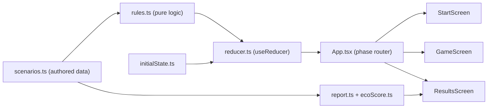
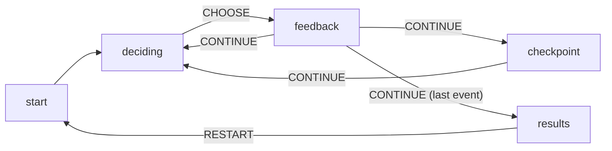

# Eco Journey One-Day MVP Implementation Plan

Version 1.0 • November 17, 2026

Source of truth: [game-design-document.md](game-design-document.md) (v1.1).
Appendix A of the GDD (the optional seven-day expansion) is **out of scope**
for this plan. Target: a playable one-day build for the November 19 playtest.

## 1. Goal

Implement the one-day Eco Journey MVP on the existing React + TypeScript +
Vite scaffold:

- Pure, tested game logic driven by authored scenario data.
- A single play screen that hosts every event (no screen per event).
- An end-of-day report that shows raw Carbon, Water, and Waste totals and a
  computed Eco Score, kept separate from the three personal goals.
- The three existing backgrounds for visuals; all other UI in plain CSS.

## 2. Current state

- Scaffold exists: `package.json`, `config/vite.config.ts` (Vitest includes
  `src/tests/**/*.test.ts`), `config/tsconfig.app.json`, `index.html`.
- Every file in `src/game/`, `src/screens/`, and `src/components/` is an
  empty stub (`export {}` or `return null`). The CSS files in `src/styles/`
  are empty.
- Art: `public/assets/backgrounds/{morning,afternoon,evening}.png` can be used
  directly. The UI, icon, portrait, prop, and effect PNGs are multi-item
  sprite sheets and are deferred to the polish phase.
- No new dependencies are needed.

## 3. Architecture



| Module | File | Responsibility |
| --- | --- | --- |
| Types | `src/game/types.ts` | Shared types for state, scenarios, options, goals, history |
| Initial state | `src/game/initialState.ts` | Fresh run state ($25, Energy 70, 7:00 AM, C/W/R 0) |
| Scenario data | `src/game/scenarios.ts` | All events, options, effects, follow-ups, feedback copy |
| Rules | `src/game/rules.ts` | Eligibility, clamped effects, arrival time, goal checks |
| Event flow | `src/game/reducer.ts` | Phases, event order, follow-up insertion, history |
| Report | `src/game/report.ts` (new) | Totals, highlights, economy summary |
| Eco Score | `src/game/ecoScore.ts` (new) | Achievable bounds and normalized score |
| UI | `src/screens/`, `src/components/` | Presentation only; dispatches reducer actions |
| Styles | `src/styles/` | Layout, theme, focus states, animations |
| Tests | `src/tests/` | Vitest suites for all game logic |

Phase flow inside the reducer:



## 4. Key implementation decisions

### 4.1 State and units

- **Money in integer cents** (start `2500`) so `$11.99` vs `$12.00` and
  `$3.50` are exact. Format only for display.
- **Energy** is clamped to 0–100, starting at 70.
- **Carbon, Water, Waste** are accumulating game impact points. They never
  buy, unlock, or block options. They are always labeled as game points,
  never as kilograms, liters, or other physical units.
- **Default-zero rule:** omitted deltas mean "not modeled." Entries the GDD
  marks as pending research (for example cleanup carbon and dishwashing
  carbon) carry an `unmodeled` note in the data for later review.

### 4.2 Eligibility

An option is disabled, with a visible reason, when:

- it costs more money than the player has,
- it requires a flag the player does not have (the reusable-bottle refill), or
- `energy + energyDelta < 0`.

Every scenario must keep at least one enabled option in every reachable
state. A test enforces this so the day can always be completed.

### 4.3 Time

- The clock is anchored to events: each scenario has a fixed scheduled time
  and advances to the next one after a choice. Real-world reading time never
  affects simulated time.
- Morning delay accumulator: long shower +15 min, quick shower 0, skip shower
  -5, pack breakfast +10.
- Arrival = commute base arrival (ride-share 7:45, bus 7:58, bike 7:55,
  Dad 7:50) + morning delay. The test goal is met if arrival is 8:00 or
  earlier.
- Commute options show the predicted arrival and a late warning before the
  player chooses.
- Other durations (bus home +25 min, dishwashing, sorting) are recorded in
  history for feedback and future balancing and do not cause missed events.

### 4.4 Follow-ups and flags

Follow-ups are declared on the parent option and inserted once, immediately
after it. They never repeat the parent option's effects.

| Parent choice | Follow-up / flag | Effect |
| --- | --- | --- |
| Buy snack + bottled drink | Bag choice (03b) | Opens immediately |
| Pack breakfast + reusable bottle | `hasReusableBottle` | Enables refill at 2:00 PM |
| Mall (any option) | Cup disposal (09b) | Fixed narrative follow-up; no charge |
| Ask Mom for ride | `momPickup`, idling choice (10b) | Opens immediately |
| Accept dishes chore | `choreAccepted`, dish method (12b) | +$5 paid once when the method is committed |

### 4.5 Goals and checkpoints

| Goal | Checkpoint | Success |
| --- | --- | --- |
| Test punctuality | After the commute choice (8:00 AM) | Arrival ≤ 8:00 AM |
| Practice readiness | After the 2:00 PM drink, before the mall (3:00 PM) | Energy ≥ 20 |
| Gift savings | After the 9:30 PM choice (10:00 PM) | Money ≥ $12.00 |

Statuses are ACTIVE, COMPLETED, or MISSED. Each goal is evaluated once and is
never revised. A missed goal never blocks progress.

### 4.6 Reducer rules

- Actions: `START`, `CHOOSE(optionId)`, `CONTINUE`, `RESTART`.
- Effects are applied only in `CHOOSE`, after eligibility is checked again.
  The reducer is pure, so React StrictMode double-invocation cannot apply an
  effect twice.
- Each decision is appended to `history` with the event, option, a
  before/after snapshot, and feedback keys.
- `RESTART` returns a fresh `initialState`. All resources, flags, history,
  and goals are reset.

### 4.7 Eco Score (included in MVP)

- `ecoScore.ts` computes the minimum and maximum achievable C, W, and R
  totals across all valid complete paths. It uses a memoized depth-first
  search over `(eventIndex, money, energy, flags)` and respects
  affordability, energy, and prerequisites. It does not naively sum each
  event's best and worst option.
- Per-metric score = `100 * (max - player) / (max - min)`, clamped to 0–100
  and rounded only for display. Higher is better.
- A category with no variation (`max === min`) is labeled "not comparable"
  and left out of the mean.
- Eco Score = the arithmetic mean of the comparable metric scores.
- The results screen always shows the raw C, W, and R totals beside the Eco
  Score. The Eco Score is captioned as a relative game score, not a
  certified environmental measure. Personal goals are reported separately and
  never feed into it.
- A snapshot test pins the computed bounds. Rerun it after any change to
  point values.

### 4.8 Core types sketch (`src/game/types.ts`)

```ts
type Flag = 'hasReusableBottle' | 'momPickup' | 'choreAccepted'

interface Effects {
  moneyCents?: number
  energy?: number
  carbon?: number
  water?: number
  waste?: number
  durationMin?: number
  morningDelayMin?: number
  baseArrivalMin?: number
  setFlags?: Flag[]
}

interface Option {
  id: string
  label: string
  effects: Effects
  requires?: Flag[]
  followUp?: ScenarioId
  payoutOnCommitCents?: number
  feedback: { outcome: string; why: string; sourceNote?: string }
}

interface Scenario {
  id: ScenarioId
  timeMin: number
  scene: 'morning' | 'afternoon' | 'evening'
  prompt: string
  options: Option[]
}

type GoalStatus = 'ACTIVE' | 'COMPLETED' | 'MISSED'
```

## 5. Phases and workstreams

Owners follow the workstreams in GDD section 13 and can be adapted.

### Phase 1: Game logic (core rules owner)

- `types.ts`, `initialState.ts`.
- `scenarios.ts`: all 14 scheduled scenarios and 4 follow-ups. Values are
  copied exactly from GDD section 7, the Waste values from Revision 1.1, and
  feedback copy from section 9. Missing copy is clearly marked as a
  placeholder.
- `rules.ts`: eligibility with reasons, clamped effect application,
  arrival-time calculation, goal evaluation.
- `reducer.ts`: phase transitions, event index, follow-up queue, history.

### Phase 2: Report and Eco Score (core rules owner)

- `report.ts`: C/W/R totals; the 2–3 biggest C/W/R contributors; 1–2 helpful
  trade-offs (choices where the player took the lowest-impact enabled
  option); money remaining, chore income, selected costs; start vs end
  Energy.
- `ecoScore.ts`: bounds and normalization as described in 4.7.

### Phase 3: Tests (QA owner with core rules owner)

All GDD section 14 acceptance tests:

| Test | Expected |
| --- | --- |
| Budget floor | With less than $8, ride-share is disabled; free alternatives work |
| Morning lateness | Quick shower + bus = 7:58; long shower + bus = 8:13 |
| Arrival boundary | 8:00 meets the goal; 8:01 misses it |
| Energy goal | Energy 20 at 3:00 PM succeeds; 19 misses |
| Gift goal | $12.00 succeeds; $11.99 misses |
| Conditional refill | Unavailable unless the bottle was packed |
| Conditional follow-ups | Bag, idling, and dish method appear only after their parent |
| Chore payout | Decline pays $0; accept + complete pays exactly $5 once |
| Metric separation | C, W, R tracked separately; never deducted as currency |
| Failure continuity | Missing any or all goals still reaches the report |
| Restart | All resources, flags, history, and goals reset |

Additional tests:

- Every scenario has at least one enabled option in every reachable state.
- Follow-ups never duplicate their parent option's effects.
- Energy and money clamping at the bounds.
- Eco Score: bounds snapshot, clamping, and "not comparable" handling.

### Phase 4: UI (UI/UX owner)

- `StartScreen`: premise, the three goals with deadlines, what each resource
  means, and a note that C/W/R are game impact points.
- `GameScreen`: hosts every event; background chosen by the scenario's
  `scene` (morning, afternoon, evening).
- `StatusBar`: time, money, energy, and compact C/W/R indicators.
- `GoalTracker`: the three goals with ACTIVE/COMPLETED/MISSED shown as text
  labels plus icons, not color alone.
- `DialogueBox`: scenario prompt.
- `DecisionPanel`: 2–5 options with known money/energy/time costs, disabled
  reasons, and the predicted arrival on commute options.
- `FeedbackPanel`: plain-language outcome, explicit variable changes, a
  "why it matters" line, and a Continue button. No green-means-correct
  language.
- `ResultsScreen`: goal cards with one-sentence explanations, raw C/W/R
  totals, the Eco Score with its caveat, decision highlights, economy
  summary, a neutral reflection, and Restart.
- `App.tsx`: owns `useReducer` and routes by phase.

### Phase 5: Styling and accessibility (visual owner)

- Fill `global.css`, `pixel-ui.css`, and `animations.css`.
- Restrained green/blue palette; readable type; high contrast.
- Full keyboard navigation with visible focus outlines.
- Respect `prefers-reduced-motion`. No timers and no required sound.
- Responsive layout for common desktop browser sizes.

### Phase 6: QA and playtest (QA owner)

- `npm test` and `npm run build` pass.
- Manual click-through of key paths: all-cheapest, all-lowest-impact,
  all-goals-missed, chore accepted, Mom pickup, bought breakfast.
- Playtest with someone outside the team using the GDD 14.1 questions; log
  defects; update the GDD for any value revisions.

### Phase 7: Post-playtest polish (does not block November 19)

- Slice the sprite sheets (portraits, props, icons, UI components) into CSS
  sprite regions and add them to scenes and cards.
- Attach a source or research note to each explanatory claim.
- Balance point values after research and playtest feedback, then rerun the
  Eco Score bounds test.

## 6. Out of scope

Seven-day mode and everything in GDD Appendix A, saves and persistence,
accounts, free movement, random events, weather generation, real-time timers,
leaderboards, online features, and a backend.

## 7. Definition of done

Per GDD 14.2: a new player can start, make decisions, encounter the required
conditional events, see correctly updated resources, meet or miss each of
the three goals, reach the final report (raw C/W/R totals plus the Eco
Score), and restart. `npm test` and `npm run build` pass, and someone
outside the implementation team has played through the build.
